# CI and CD Workflow :

## 1st Setup the code ()
- create a simple Springboot curd with DB application

link : https://github.com/Ashfaqbs/Springboot3-crud-example

- push to github repo.
(so jenkins will take the project from repo and also we can create a cron job to take the continuous push if success it will create successful build else the build triggerd from cron will fail until a success or correct code with no syntax error and Junit test is pushed to repo)
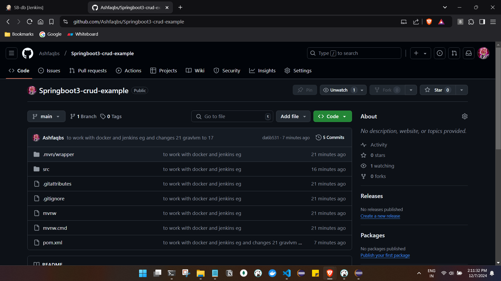
- Carefull when working with grallVM as some build were failing, so as of now we have done some changes in pom

## 2nd Create a jenkins job

- Login to jenkins dashboard and select new item, select the jenkins job name, select freestyle option and ok (same as simple rest api project)

- Next provide the respective data for the job.
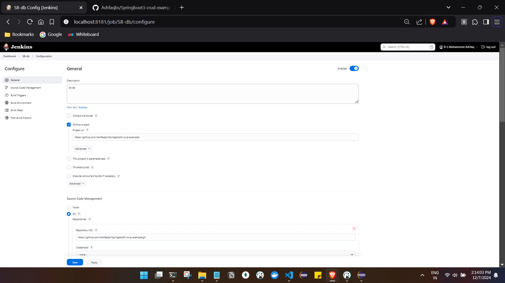
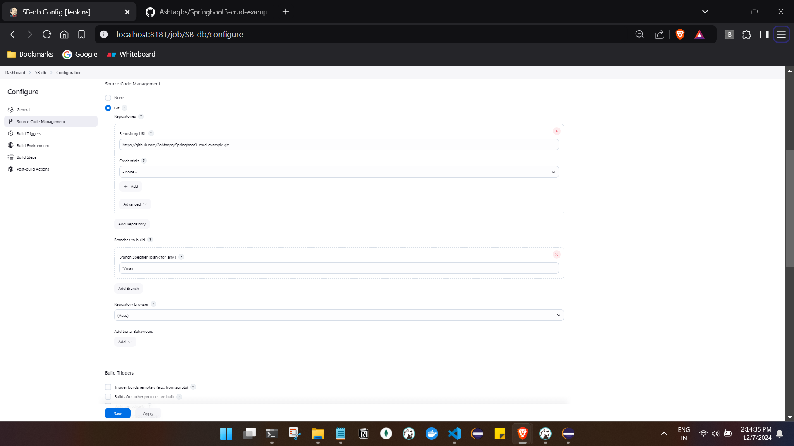
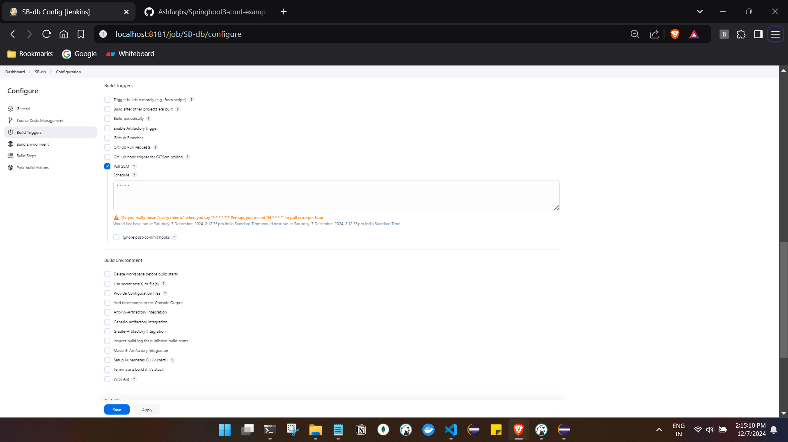

- apply and save the job .

- build should be started :
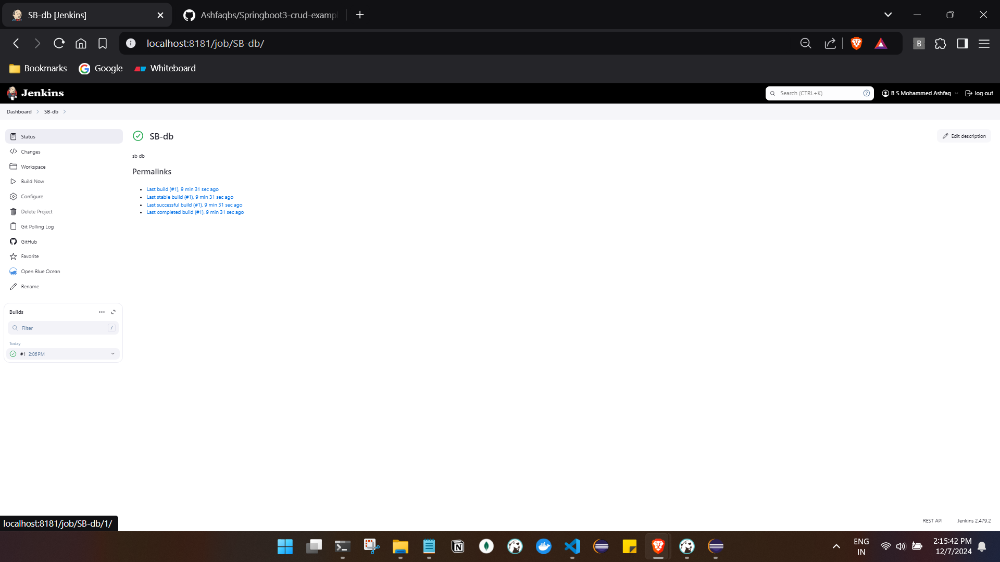
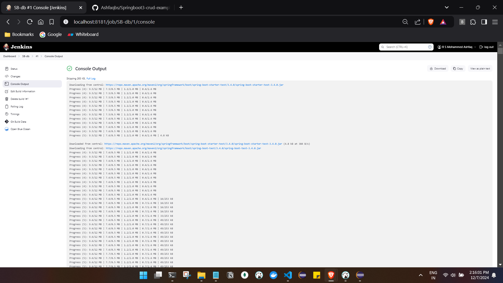
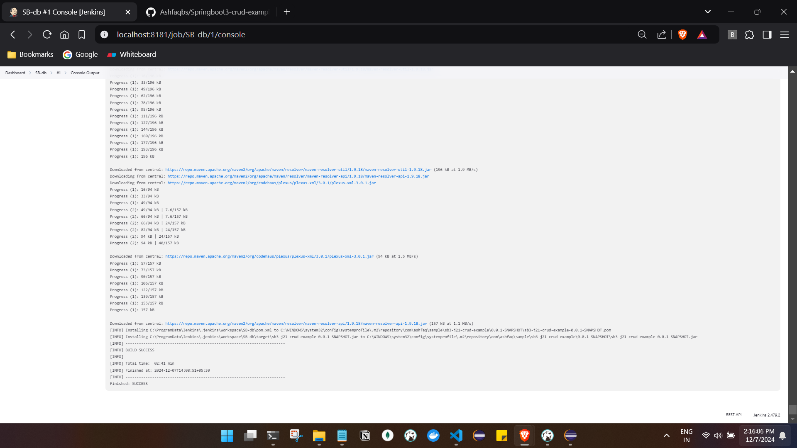

- Testing out the application:
- download the jar as we had done in simple rest api project and run

## Retrigger the build automatically:

- made some minor changes in repo 
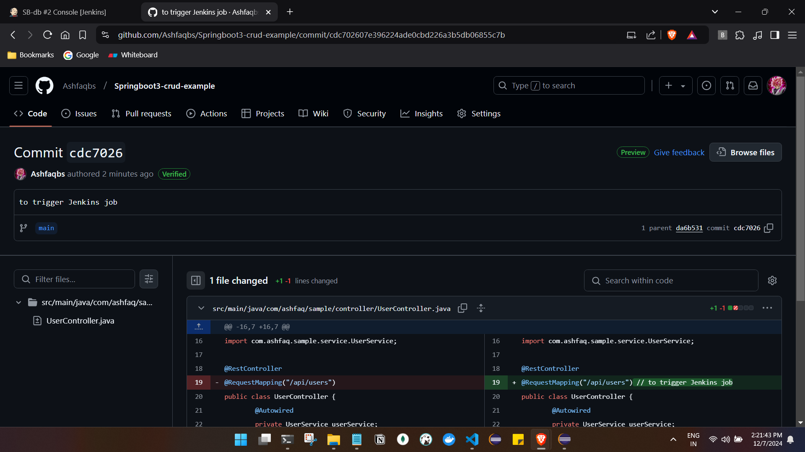

- in some time the build will be triggered automatically:
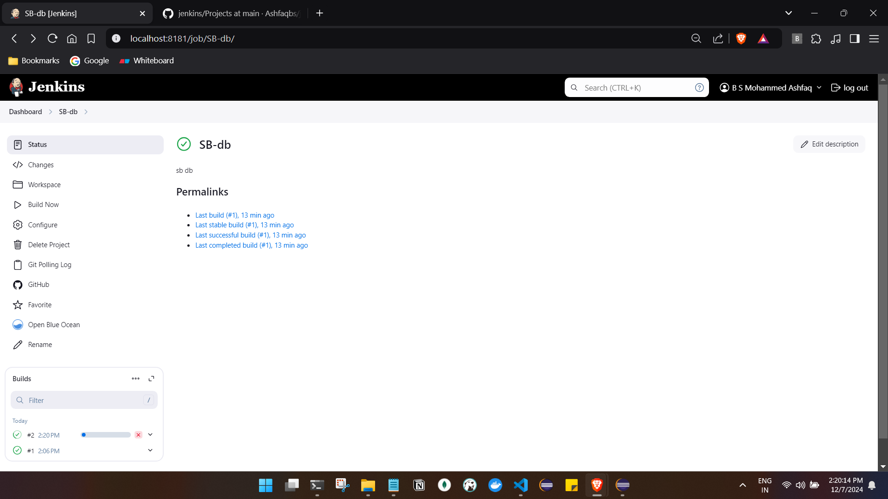
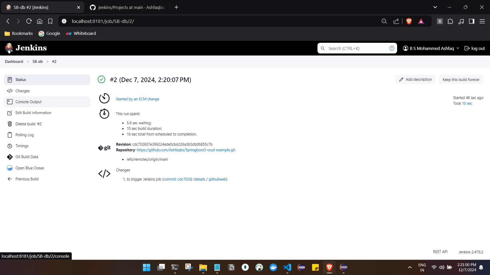
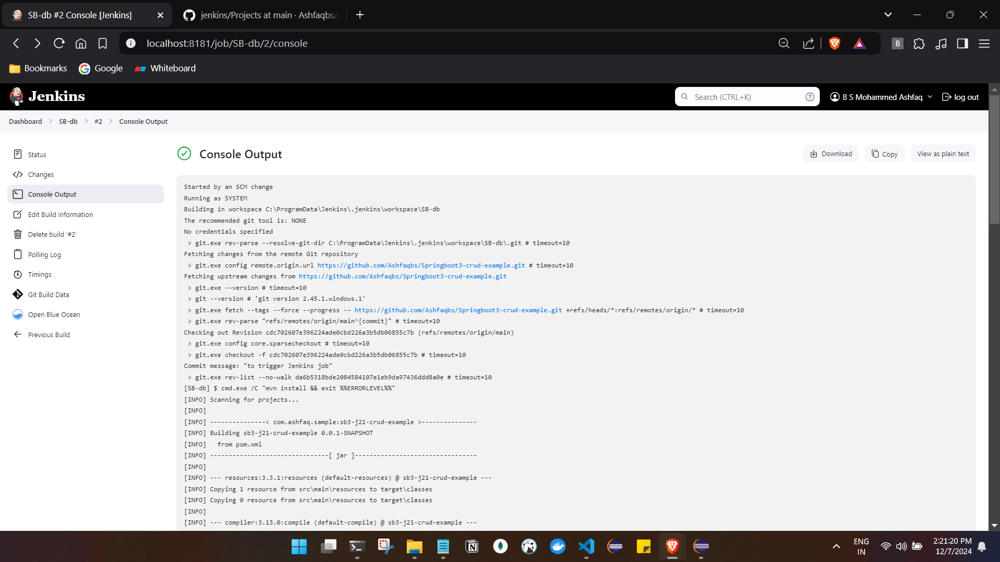
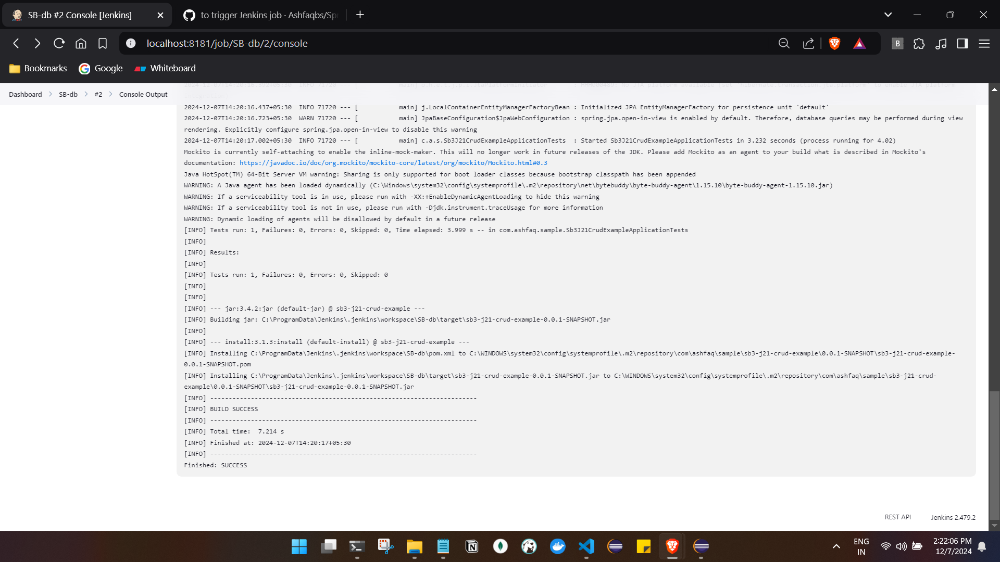