# CI and CD Workflow :

## 1st Setup the code ()
- create a simple Springboot restapi with no DB application
(we will use a public application) 

link :https://github.com/bezkoder/spring-boot-3-rest-api-example

- push to github repo.
(so jenkins will take the project from repo and also we can create a cron job to take the continuous push if success it will create successful build else the build triggerd from cron will fail until a success or correct code with no syntax error and Junit test is pushed to repo)

## 2nd Create a jenkins job

- Login to jenkins dashboard and select new item 
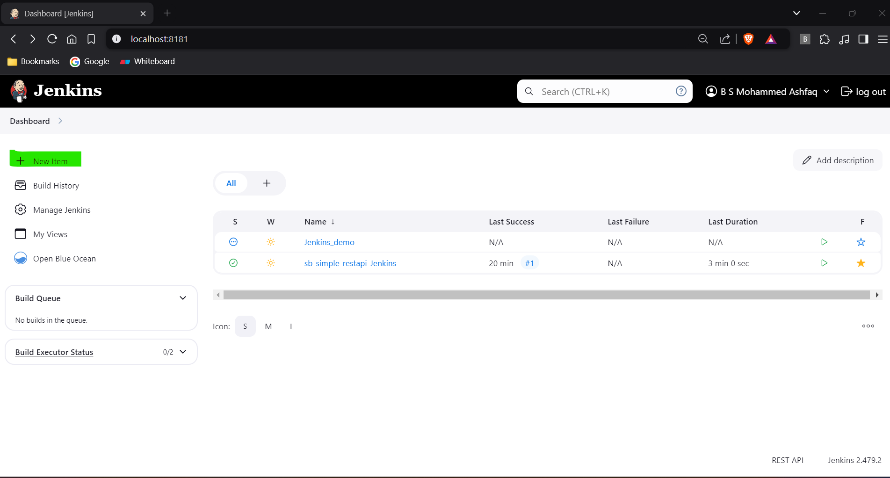
- Create the jenkins job name and select freestyle option and ok.
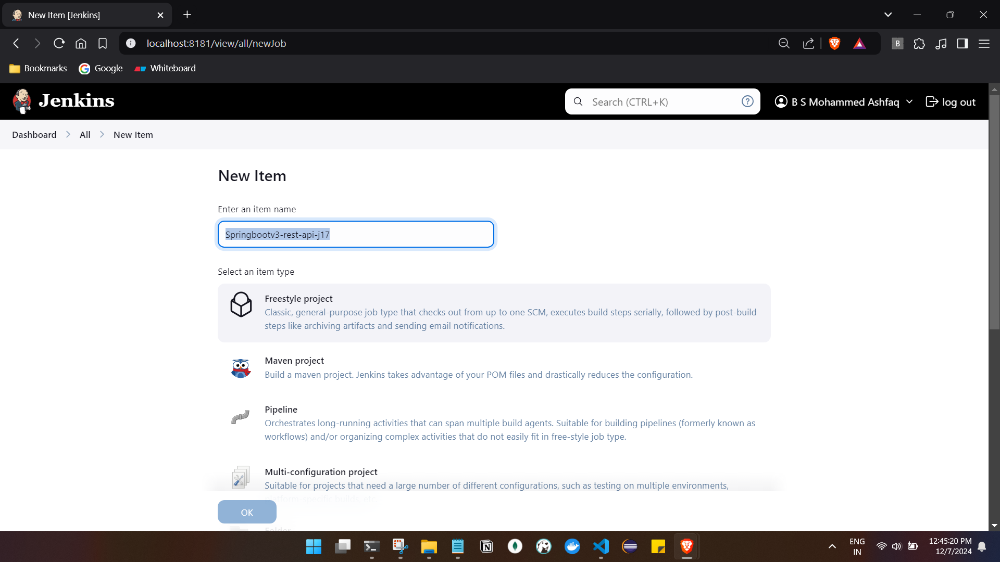
- provide the description and git url
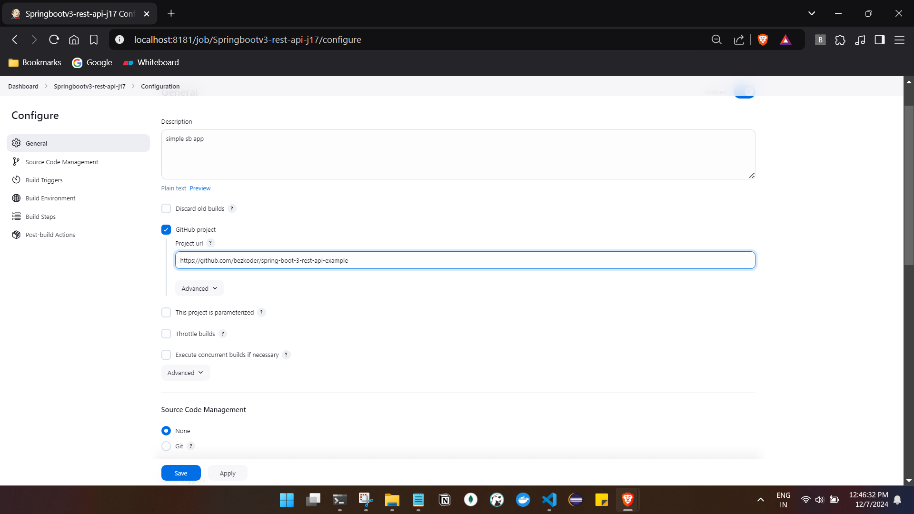
- select Source Code Management and select github origin and provide the branch name 
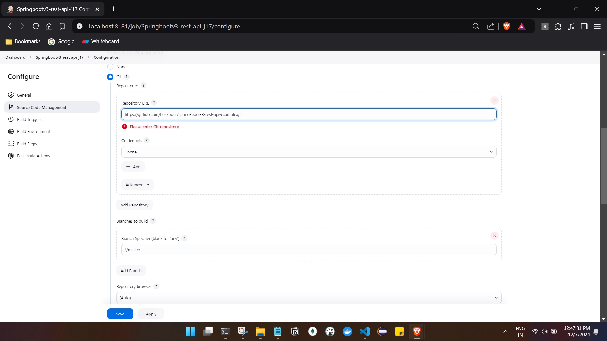
-In build triggers select poll scm every minute
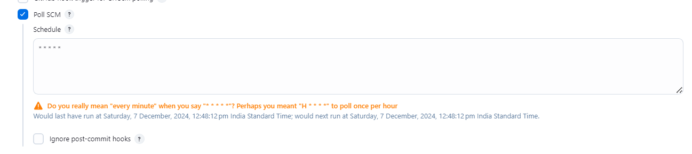
- no changes in Build Environment
- In build steps select Invoke top-level Maven targets
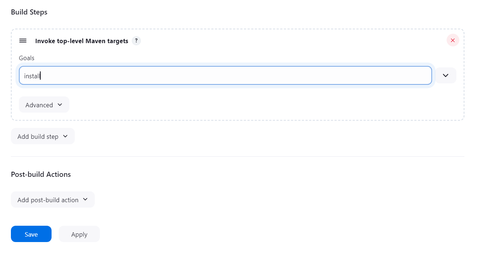
- no changes in post build actions

and click on save.

## 3rd Automatic build creation will be triggered from cron job and also from github push 
- Result :

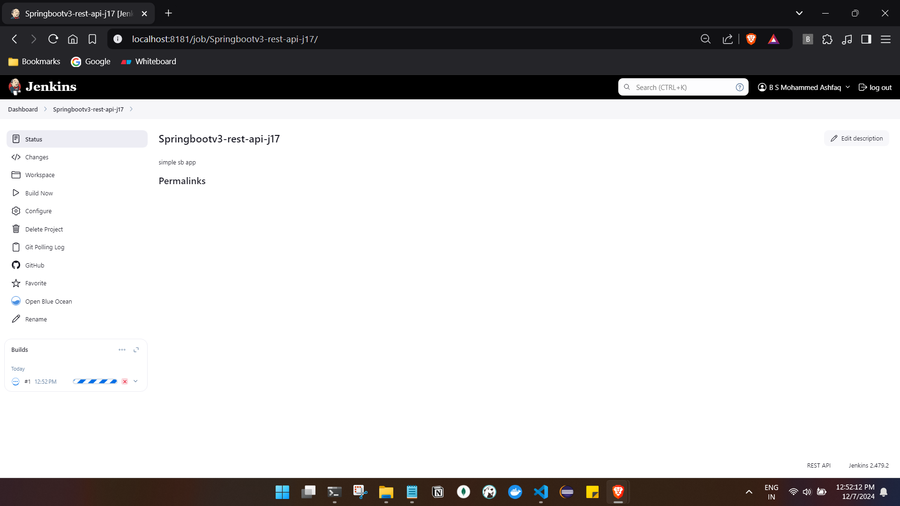
- click on the #1 build to see the console logs 
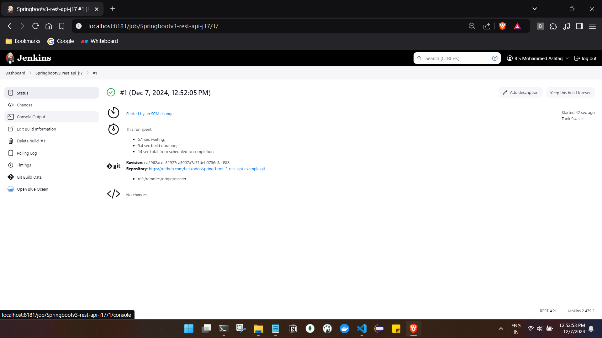
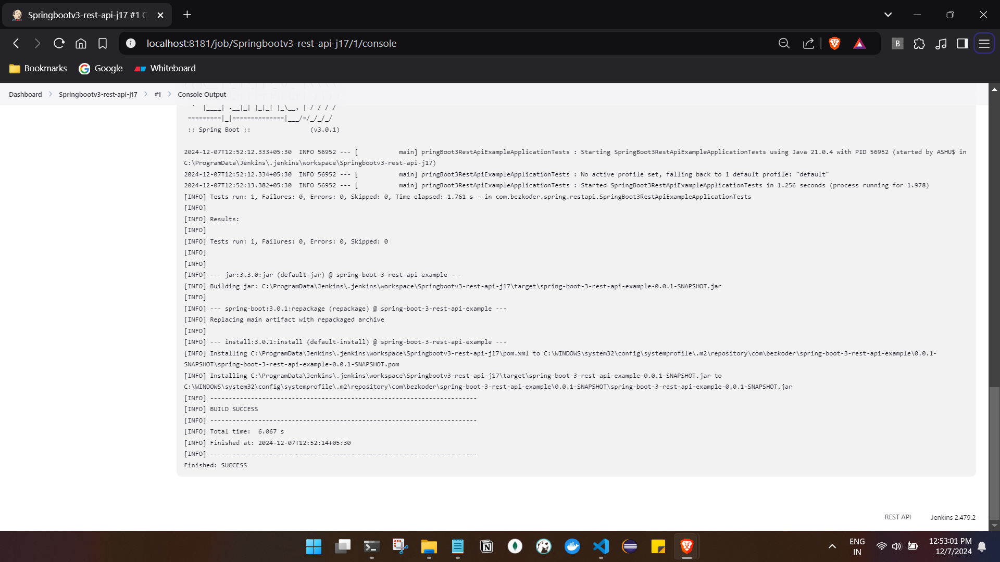

## Running the code locally :

- in order to run the code locally we need jar which can be downloaded from 

1. 
- go to wrokspace and download as zip and run the jar .
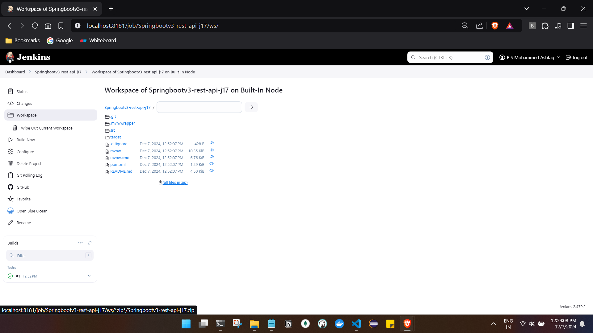

2.
- the work space will be created in appdata where we can access the jar files

```
Path : 
C:\ProgramData\Jenkins\.jenkins\workspace
```
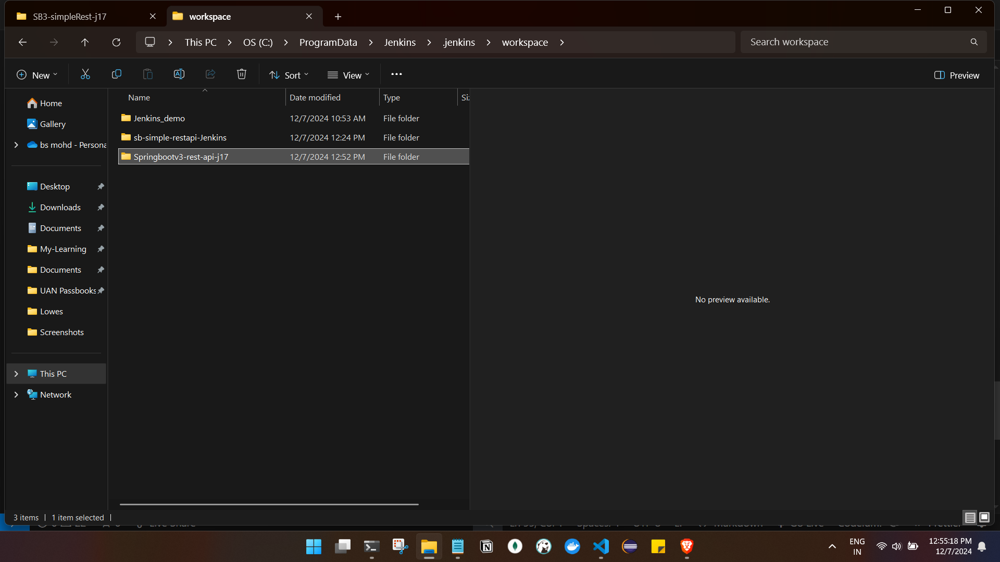
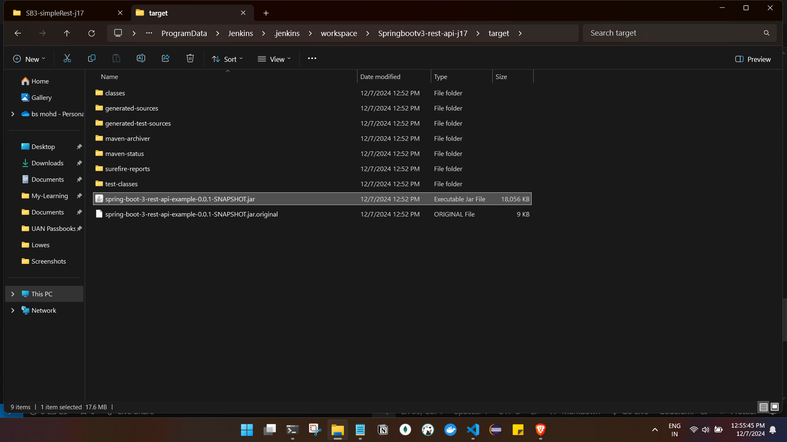
- Running the jar file
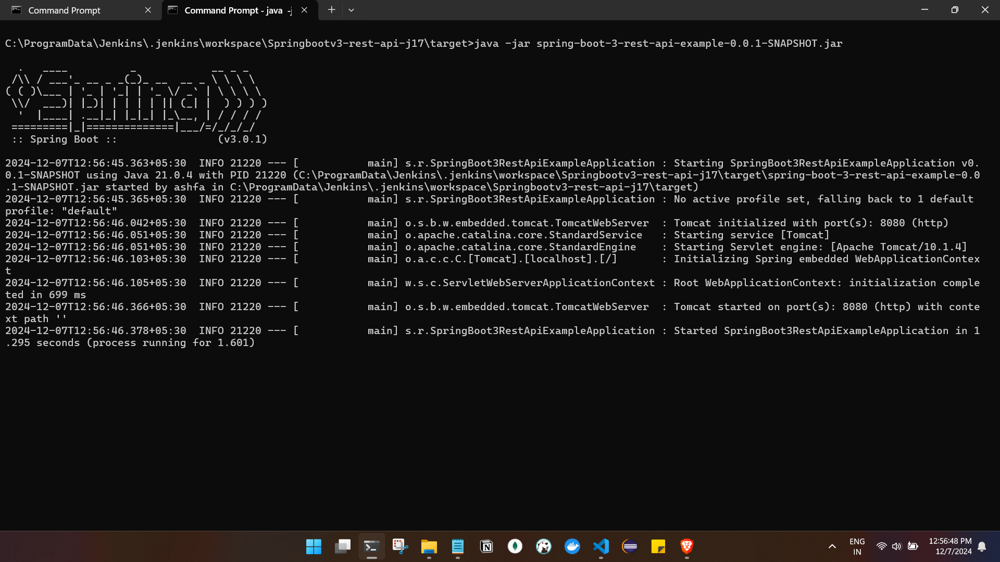